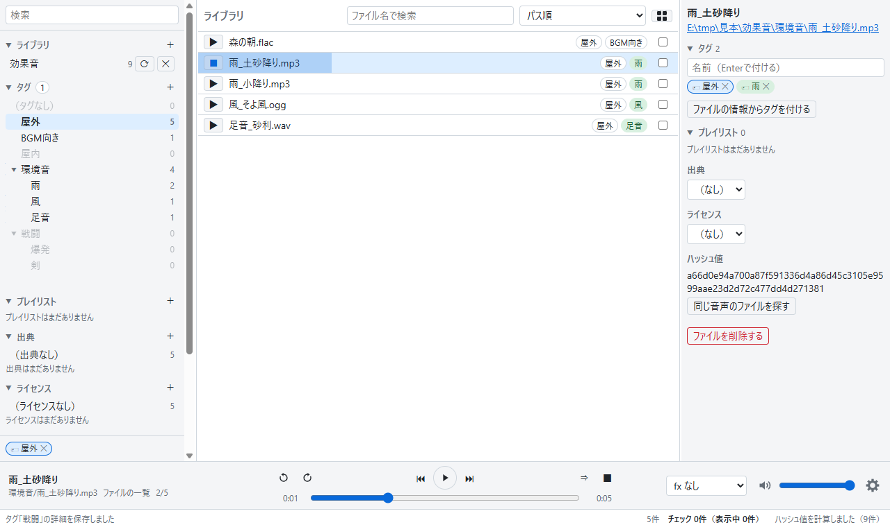
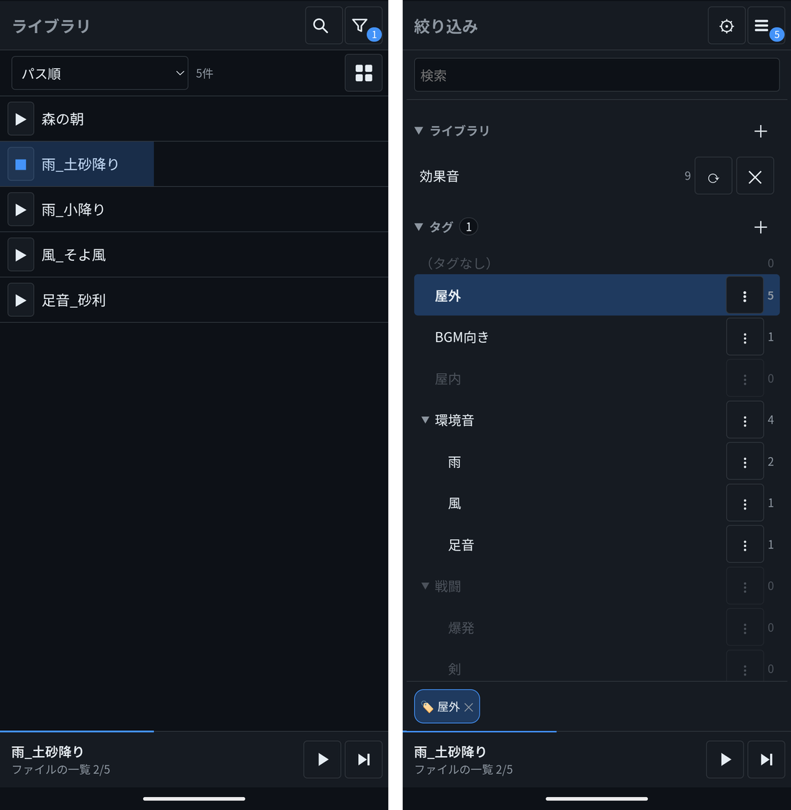
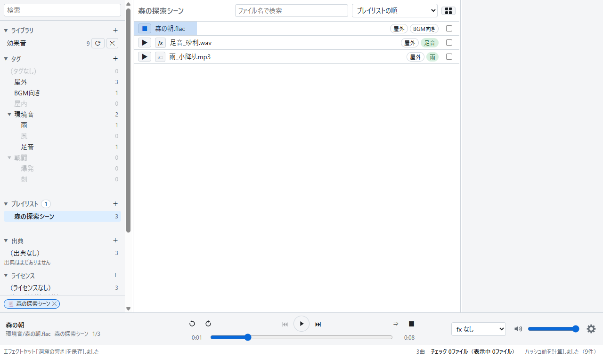
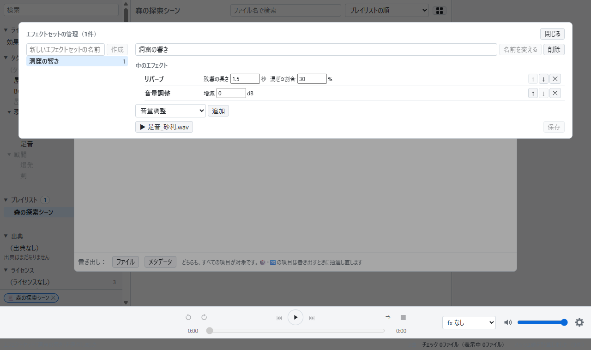

# cyanomelody

効果音や BGM などの音声ファイルに「タグ」を付けて整理し、聞きたい音をすぐに探して鳴らせる Windows 向けのアプリです。Android 版もあり、Windows で整理した曲とタグなどをスマホに写して使えます。

## このアプリの特徴

- フォルダを登録するだけで、中の音声ファイル（MP3・WAV・FLAC・OGG・M4A）を一覧にします。数万ファイルでも軽く動きます。
- ファイルに「雨」「足音」「屋外」のような自由なタグを付けられます。タグは「環境音」の下に「雨」を置くような階層にでき、色も付けられます。タグに別の名前（「rain」など）を付けておくと、その名前でも探せます。
- ファイルの中の情報（アーティスト・アルバム・ジャンル・作曲者）を読み取って、まとめてタグにできます。
- タグや出典・ライセンス、長さ、リリース年などの条件を組み合わせて、ファイルを絞り込めます。
- 行の「▶」ですぐに試聴できます。↑↓キーで次々に聞き比べることもできます。
- 一覧は、行で並べるほかに、ジャケット（曲の中の画像）を並べるグリッドでも見られます。
- 「プレイリスト」に、ファイルだけでなく「雨のタグが付いた音からランダムに1つ」のような指定も入れられます。シーンごとの音の組み合わせ作りに便利です。
- リバーブや音量調整などのエフェクトをかけて鳴らせます。プレイリストを、エフェクトをかけた状態でフォルダに書き出すこともできます。
- 素材の出典やライセンス（商用利用の可否など）を記録しておけます。
- たくさんのファイルをチェックして、タグ・プレイリスト・出典などをまとめて設定できます。
- 中身が同じ音声（重複しているファイル）を見つけたり、移動したファイルのタグを付け直したりできます。
- 元の音声ファイルは書き換えません。タグなどの情報は、アプリの中だけに保存します（ファイルを削除する操作をしたときだけ、ファイルを Windows のごみ箱に移します）。
- タグなどの情報をファイルに書き出して、バックアップや別の PC への移し替えに使えます。
- 新しい版が出ると、起動したときにお知らせし、そのままアップデートできます。
- Android 版：USB でつないだスマホへ、ライブラリの全曲とタグ・プレイリストなどをまとめて写して使えます。画面をロックしても再生が続きます。

## 動作環境

- Windows 11（Windows 10 でも動く見込みです）
- Android 版：Android 7.0 以上の、64ビットの ARM のスマホ（今のスマホのほとんど）
- インターネットの接続は、アップデートを確かめるときだけ使います。

## 導入方法

アプリは [Releases（リリース）のページ](https://github.com/Taniguchi-EX/cyanomelody/releases/latest)からダウンロードします。Windows 版と Android 版は、同じページの「Assets」の中にあります。

### Windows 版

#### 1. ダウンロード

Releases のページの「Assets」の中にある `cyanomelody_1.3.1_x64-setup.exe` のようなファイル（数字は版によって変わります）をクリックしてダウンロードします。

#### 2. インストール

ダウンロードしたファイルをダブルクリックすると、インストールが始まります。画面に従って進めてください。管理者の権限は要りません。

「Windows によって PC が保護されました」という青い画面が出ることがあります。これは、このアプリに有料の電子署名を付けていないために出るもので、ウイルスが見つかったという意味ではありません。次のようにすると、インストールを続けられます。

1. 「詳細情報」をクリックします。
2. 下に出てくる「実行」ボタンをクリックします。

インストールが終わると、スタートメニューに「cyanomelody」が加わります。

#### アップデート

新しい版が公開されると、アプリを起動したときに「新たなバージョンが公開されました。アプリをアップデートしますか？」と表示されます。

- 「はい」：新しい版をダウンロードしてインストールし、アプリを起動し直します。
- 「いいえ」：今回はアップデートしません。次に起動したときに、また表示します。
- 「このバージョンをスキップ」：その版ではもう表示しません。もっと新しい版が出たときに、また表示します。

#### アンインストール

Windows の「設定」→「アプリ」→「インストールされているアプリ」から「cyanomelody」をアンインストールします。登録した音声ファイルそのものは消えません。

### Android 版（スマホ）

#### インストール

1. スマホで Releases のページを開き、「Assets」の中にある `cyanomelody_1.3.1_android-arm64.apk` のようなファイル（数字は版によって変わります）を押してダウンロードします。
2. ダウンロードしたファイルを開きます。「この提供元からの不明なアプリをインストールすることはできません」と出たときは、「設定」を押して「この提供元のアプリを許可」をオンにし、戻ってもう一度開きます（ダウンロードに使ったブラウザやファイルのアプリへの許可です）。
3. 「インストール」を押します。「Play プロテクト」の確認が出ることがあります。これは Google Play 以外から入れるアプリに出るもので、ウイルスが見つかったという意味ではありません。詳細を開いて、インストールを続けてください。

インストールが終わると、ホーム画面のアプリの一覧に「cyanomelody」が加わります。曲とデータは、次の「Android 版」の章のとおりに Windows から写します。

#### アップデート

新しい版が公開されると、アプリを開いたときに Windows 版と同じお知らせが出ます。「はい」を押すとダウンロードし、Android のインストールの画面が開くので、「更新」を押します（開くアプリを聞かれたら「パッケージインストーラ」を選びます）。初めてのときは「この提供元のアプリを許可」の画面が出るので、オンにしてアプリに戻り、「もう一度開く」を押してください。データはそのまま残ります。

#### アンインストール

スマホの「設定」→「アプリ」から「cyanomelody」をアンインストールします。スマホに写した曲（`Music/cyanomelody`）は消えないので、要らなければファイルのアプリで消してください。

## Android 版

Windows 版で整理した曲とタグ・プレイリストなどを、スマホに写して使えます。スマホの画面に合わせた作りですが、できることは Windows 版とほぼ同じです（ファイルの削除や書き出しなど、一部の操作はありません）。

### Windows の曲とデータを写す

1. スマホを USB で PC につなぎ、スマホのロックを解除して、通知の「USB の設定」で「ファイル転送」を選びます。
2. Windows 版の設定画面（再生の欄の右端の歯車）の「データ」で「スマホへコピー…」を押し、写す曲の数を確かめてから写します。スマホの `Music/cyanomelody` に、ライブラリの全曲とデータが写ります。2回目からは、変わった曲だけを写します。
3. スマホの cyanomelody を開き、設定画面（絞り込みの画面の歯車）の「データ」で「フォルダを設定する…」を押して、`Music/cyanomelody` を選び「このフォルダを使用」→「許可」を押します（最初の1回だけ）。
4. 「取り込む」を押すと、タグ・プレイリストなどが Windows のとおりになります。次からは、Windows から写した後にアプリを開くと「Windows から新しいデータが写されています」と出るので、「取り込む」を押します。

### スマホでの使い方

- アプリを開くと、ファイルの一覧が出ます。右上の漏斗のボタンで絞り込みの画面（Windows の左の欄と同じもの）に切り替わり、タグやプレイリストを押して絞り込めます。
- 一覧の行の「▶」で鳴らします。行を押すと、そのファイルの詳細（タグなど）が開きます。行を長押しすると、チェックしてまとめて操作できます。
- 画面の下の再生エリアを押すと、全画面の再生が開きます。
- 画面をロックしても再生は続き、ロック画面や通知の欄、イヤホンのボタンからも操作できます。イヤホンを抜くと一時停止します。

## 大まかな操作方法（Windows 版）

画面は、左の欄（絞り込み）、中央（ファイルの一覧。プレイリストを選ぶと、その曲の並び）、右の欄（選んだファイルの詳細）、下の再生の欄に分かれています。再生の欄の右端の歯車で、設定画面を開きます。

### 音声ファイルを登録する

左の欄の「ライブラリ」の「＋」を押し、音声ファイルが入っているフォルダを選びます。中のファイル（サブフォルダの中も含む）が、中央の一覧に並びます。

フォルダの中のファイルを増やしたり消したりしたときは、そのフォルダの行の「⟳」を押すと、一覧に反映されます。

### 聞く

- 一覧の行の「▶」を押すと、その行から鳴らします。行をダブルクリックしても鳴らせます。
- 行を押して選んでから ↑↓キーを押すと、上下のファイルに移ります。鳴らしている間なら、移った先を続けて鳴らします。スペースキーで、選んだファイルを鳴らす・止めることもできます。
- 下の再生の欄で、一時停止・前へ・次へ・停止、10秒戻す・進める、再生位置、音量を変えられます。
- 再生の欄の再生方法のボタンを押すたびに、「① 一曲だけ」「⇒ 順に連続」「🔀 ランダム」「🎲 ランダムセレクト（1曲だけ選ぶ）」と変わります。
- 再生の欄の曲名を押すと、今鳴らしている音の行に飛びます。
- 一覧の右上のボタンで、行の一覧とグリッド（ジャケットを並べた形）を切り替えられます。

### タグを付ける

- 一覧の行を押すと、右の欄にそのファイルの詳細が出ます。右の欄のタグの入力欄に名前を入れて Enter を押すと、タグが付きます。まだないタグは新しく作られます。
- 一覧の行を、左の欄のタグの上にドラッグしても付けられます。行のチェックボックスでまとめてチェックしてからドラッグすると、チェックしたファイルすべてに付きます。
- 右の欄のタグの「✕」で外せます。
- 右の欄の「ファイルの情報からタグを付ける」で、ファイルの中のアーティスト・アルバム・ジャンル・作曲者をタグとして付けられます。
- 左の欄のタグは、行をドラッグして並べ替えたり、別のタグの中に入れて階層にしたりできます。
- タグの行の「✎」で、名前・色・子のタグの並び順・別の名前（シノニム）を変えられます。

### まとめて操作する

- 一覧の行の右端のチェックボックスで、ファイルをチェックします（Shift を押しながら押すと、間の行もまとめてチェックします）。
- 一覧の下の「一括操作」を押すと、右の欄が一括操作の欄になり、チェックしたファイルすべてに、タグの付け外し・ファイルの情報からのタグ付け・プレイリストへの追加・出典やライセンスの設定などができます。
- ファイルの削除（Windows のごみ箱へ移す）も、右の欄か一括操作の欄の一番下からできます。

### 絞り込む

- 左の欄のタグを押すと、そのタグが付いたファイルだけになります。いくつか押すと、すべてのタグが付いたファイルに絞り込みます。
- 出典・ライセンス・「その他」（重複しているファイル、直近で再生したもの、長さ、リリース年など）でも絞り込めます。
- 中央の上の「ファイル名で検索」で、名前でも絞り込めます。その右のプルダウンで、並び順（パス順・ファイル名順・追加した順・長さ順など）を変えられます。
- 選んでいる条件は左の欄の一番下に並び、「✕」で外せます。
- 左の欄の一番上の検索の欄では、タグやプレイリストを名前で探せます。

### プレイリストを作る

1. 左の欄の「プレイリスト」の「＋」を押し、名前を入れて Enter を押します。
2. 一覧の行（チェックしたファイル）を、左の欄のプレイリストにドラッグして加えます。
3. 左の欄のプレイリストをダブルクリック（または「✎」）すると、中身を直す編集画面が開きます。
   - タグの入力欄でタグを並べて「タグの組み合わせを追加」を押すと、「そのタグが付いた音」を項目として加えられます。項目ごとに、順に鳴らすか（▶ 順に）、並べ替えるか（🔀 シャッフル）、ランダムに1つ選ぶか（🎲 1曲）を決められます。
   - 「プレイリストを追加」で、別のプレイリストを中に入れることもできます。
   - 項目は行をドラッグして並べ替えられます。「✎」で、プレイリスト上での名前を付けられます。
   - 「▶ 再生」で、そのプレイリストを頭から再生します。
4. 左の欄のプレイリストを押すと、そのプレイリストで鳴らす曲の並びが中央に出ます（ランダムに1つ選ぶ項目などは、このときに決まります。選び直すと決め直します）。タグなどでさらに絞り込めます。
5. 再生の欄の「▶」で、中央に並んだ曲を、プレイリストとして（エフェクトをかけて）再生します。
6. 編集画面の一番下の書き出しの「ファイル」で、プレイリストの曲をフォルダに書き出せます（エフェクトをかけた音も書き出せます）。「メタデータ」では、曲のタグなどの情報を JSON に書き出せます。

### エフェクトをかける

- プレイリストの編集画面で、項目の「fx なし」のプルダウンで「新しいfxを作る」を選ぶと、エフェクトセット（エフェクトの組み合わせ）を作る画面が開きます。リバーブ・音量調整などを加えて「保存」すると、その項目に付きます。
- 再生の欄の右のプルダウンでエフェクトセットを選ぶと、再生するすべての音にかかります。このプルダウンの「新しいfxを作る」からも作れます。
- 作る画面の試聴のボタンで、かけた音をその場で聞けます。
- エフェクトをかけても、元の音声ファイルは変わりません。

### 出典・ライセンスを記録する

左の欄の「出典」「ライセンス」の「＋」で登録し、右の欄のプルダウンでファイルに設定します。一覧の行を、左の欄の出典・ライセンスにドラッグしても設定できます。

### 設定

再生の欄の右端の歯車で、設定画面を開きます。

- 一般：戻す・進める秒数、新しく作るタグの色などの既定値。
- 表示：文字の大きさ・フォント、グリッドの横の数、ファイル名の拡張子を省くかどうか。
- データ：エクスポート・インポートと、スマホへのコピー（下の「データの保存場所とバックアップ」と「Android 版」）。
- バージョンとライセンス：アプリの版と、使っているライブラリのライセンス。

## データの保存場所とバックアップ

タグやプレイリストなどの情報は、`%APPDATA%\dev.cyanomelody.app` に保存されます。アンインストールのときに、この情報も消すかどうかを選べます。消さなければ、もう一度インストールしたときにそのまま使えます。

設定画面の「データ」の「エクスポート…」で、タグ・プレイリスト・エフェクト・出典とライセンス・設定などを1つのファイル（JSON）に書き出せます。書き出したファイルを、別の PC の「インポート」の「ファイルを選ぶ…」で選んで「取り込む」を押すと、同じタグなどを使えます（曲はファイルの場所や中身で見分けて対応させます）。

## ライセンス

[MIT License](LICENSE)
