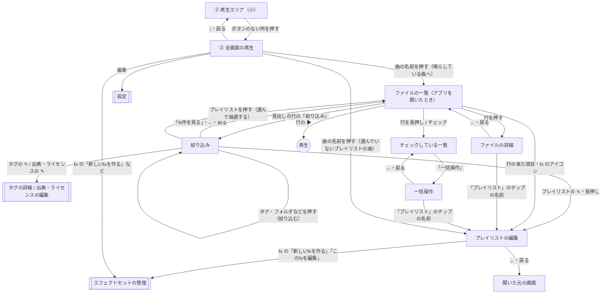

# 画面遷移（案）

ユーザーのイメージ（動的エリア・再生エリア）をもとにした案。Windows の画面は変えない。
未決のところは、最後の「決めること」にまとめる。

## 画面の構成

縦向きの画面を、上下2つのエリアに分ける（上下は、端末のステータスバー・ナビゲーションバーの分を空ける（セーフエリア））。

```
┌──────────────────────────┐
│ 見出しの行（画面ごと）       │ ← 動的エリアの中の、それぞれの画面の一番上
│ ……                        │
│ ① 動的エリア               │ ← 絞り込み / ファイルの一覧 / ファイルの詳細 /
│                          │    一括操作 / プレイリストの編集 を切り替える
│                          │
├──────────────────────────┤
│ ② 再生エリア（小）          │ ← 常に出す。ボタンのない所を押すと、全画面の再生
└──────────────────────────┘
```

- ① 動的エリア：下の「画面の一覧」の画面を出す。画面を切り替える専用のバーは置かず、切り替え・戻るの操作は、それぞれの画面の一番上の見出しの行に置く。
  - ファイルの一覧の見出しの行：見出し（ライブラリかプレイリストの名前）と、「絞り込み」のボタン（漏斗の絵。選んでいる条件の数を添える）。押すと絞り込みの画面を開く。
  - 絞り込みの見出しの行：「←」（一覧へ戻る）と、「N件を見る」のボタン（今の条件で一覧に出る件数）。押すと一覧へ戻る。
  - 中に入った画面（ファイルの詳細・一括操作・プレイリストの編集）の見出しの行：「←」（戻る）と画面の名前。
  - 見出しの行は、その画面をスクロールしても一番上に残す。
- ② 再生エリア（小）：曲の名前、「▶／⏸」「⏭」、進み具合の細い線。ボタンのない所を押すと、全画面の再生（③）を開く。
- アプリを開いたときは、ファイルの一覧を出す。

## 画面の一覧

- 絞り込み：左の欄：検索、ライブラリ・タグ・プレイリスト・出典・ライセンス・その他、条件のチップ
- ファイルの一覧：中央の欄：見出し（ライブラリかプレイリストの名前）、ファイル名の検索、並び順、一覧・グリッド、チェックの行
- ファイルの詳細：右の欄（ファイル1件）：曲名・パス、タグ、出典・ライセンス、プレイリスト、ファイルの情報からタグを付ける、リンク切れの操作
- 一括操作：右の欄（一括操作）：チェックしたファイルへのタグ・プレイリスト・出典・ライセンス・タグ付け・リンク切れの操作
- プレイリストの編集：重ねて出していた編集画面：項目の並び・再生方法・fx・別名、項目の追加、名前
- ③ 全画面の再生：再生の欄の全部：曲の名前・ファイル名・どこから再生しているか、シークバー、戻す・進める、⏮ ▶ ⏭、再生方法、■、fx、音量、設定の歯車
- 重ねて出す画面：タグの詳細、出典・ライセンスの編集、エフェクトセットの管理、設定、確認のダイアログ（今のまま、全画面に広げて出す）

## 画面遷移図



- 「戻る」は、見出しの行の「←」と、端末の戻る操作（ジェスチャー・戻るボタン）の両方で同じに動く。開いた順に戻り、ファイルの一覧で戻ると、アプリを閉じる（Android の決まり）。
- 再生エリア（小）は、全画面の再生（③）以外のすべての画面の下に出す。重ねて出す画面（タグの詳細など）を開いている間も出す（Windows と同じ）。

## 主な操作の流れ

- 絞り込んで再生する：一覧の「絞り込み」→ タグを押す（続けて足せる）→「N件を見る」→ 行の ▶。
- プレイリストを再生する：一覧の「絞り込み」→ プレイリストを押す → 一覧に抽選した並びが出る → 再生エリアの ▶。
- ファイルにタグを付ける：一覧で行を押す → ファイルの詳細でタグを入れる → 戻る。
- まとめてタグを付ける：一覧で行を長押し（チェック）→ ほかの行も押してチェック → 「一括操作」→ タグを入れる。
- プレイリストを直す：一覧の「絞り込み」→ プレイリストの ✎（または長押し）→ プレイリストの編集。

## Windows との違い（狭い画面のため）

- ドラッグでの操作（行をタグ・プレイリストへ落とす、並べ替え）は、指では難しいので、代わりの操作を用意する（例：一括操作の欄からタグ・プレイリストに加える。並べ替えは「↑」「↓」か長押しして動かす）。
- 行のマウスを乗せたときの操作（左の欄の「✎」「🗑」、「+N tags」の一覧）は、長押しか、常に出す形にする。
- Android で使えない操作（ファイルの削除・エクスプローラーで見せる・ファイルを1つ選んでのひも付け・自動アップデート・データの入出力）は出さない。

## 決めること

- 3つ目のエリア（切り替えのバー）は置かない（決定）。切り替え・戻るは、それぞれの画面の見出しの行に置く。

1. 一覧と絞り込みの行き来：一覧の見出しの行の「絞り込み」と、絞り込みの「N件を見る」でよいか。
2. 「再生しているファイルのリスト」は、絞り込んだ「ファイルの一覧」（中央の欄）のことでよいか。それとも、再生の順番（キュー：今鳴らしている順番）を別に出す画面がほしいか。
3. 絞り込みの画面で条件を押したとき、絞り込みの画面のまま（続けて条件を足せる）にするか、一覧へ移るか（案：プレイリストを選んだときだけ一覧へ移り、ほかは絞り込みの画面のまま）。
4. 一括操作は、一覧のチェックの行の「一括操作」から開く別の画面でよいか。
5. 全画面の再生（③）を閉じる操作：下へのスワイプと「↓」ボタンと戻る操作でよいか。
6. 設定を開く場所：全画面の再生の中（Windows の再生の欄の右端と同じ並び）でよいか。絞り込みの画面の見出しの行に置く案もある。
